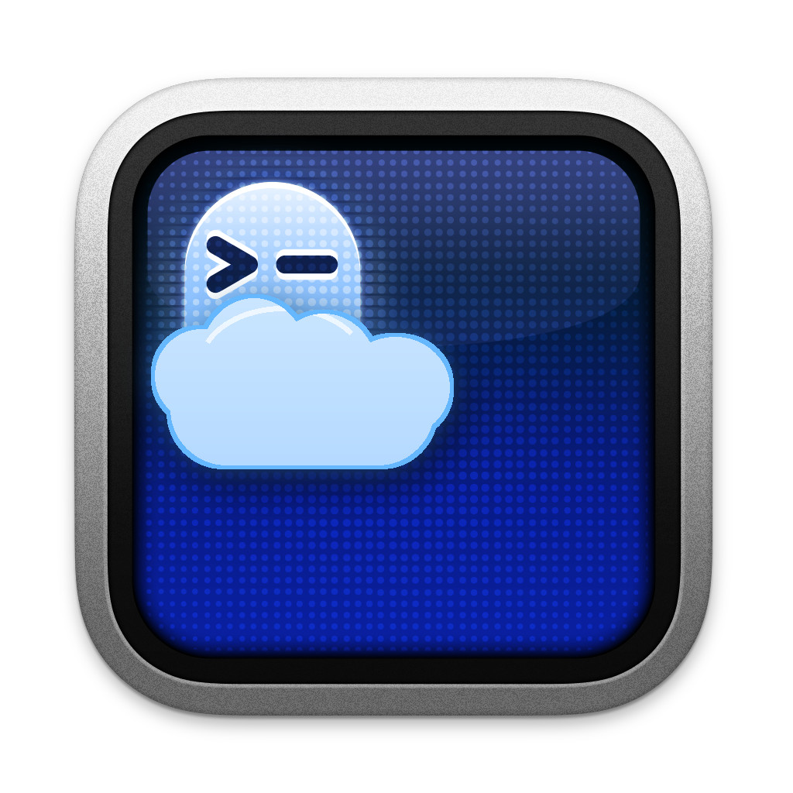
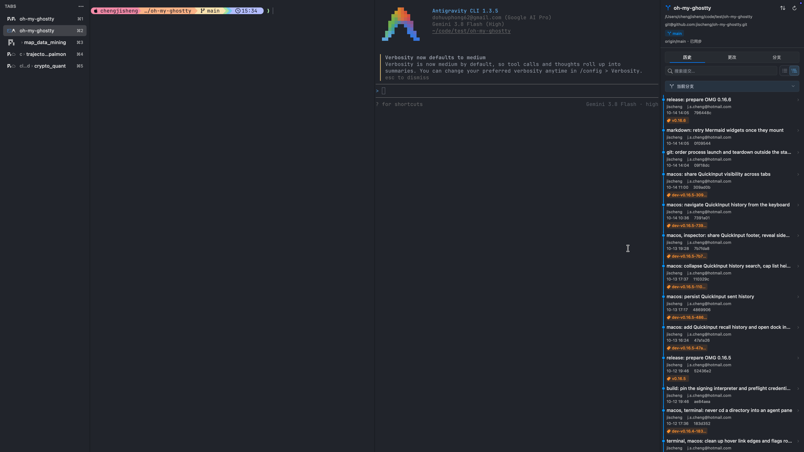
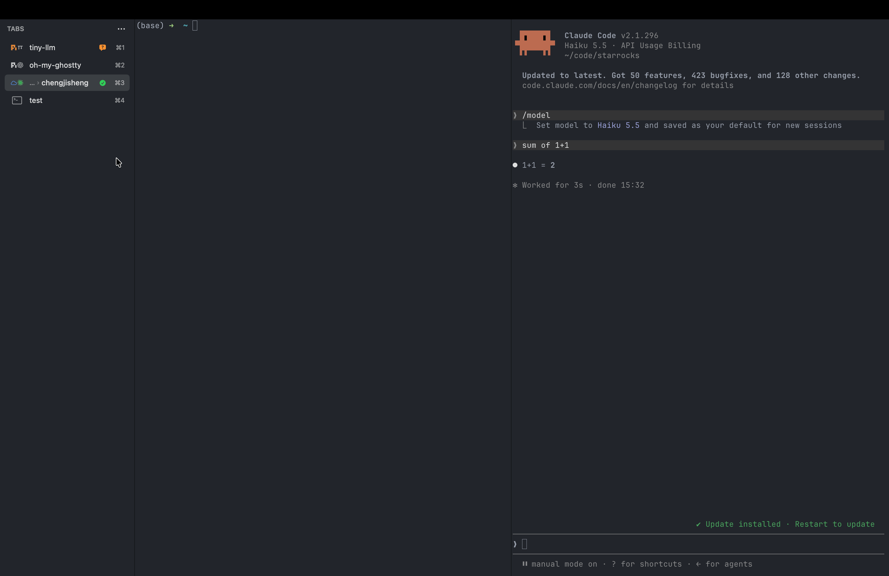

<p align="center">
  
</p>

<h1 align="center">Oh My Ghostty · OMG</h1>

<p align="center">
  基于 Ghostty，为 AI Agent 工作流扩展的 macOS 终端。
  <br>
  在一个原生窗口中处理 Agent、输入草稿、文件与 Git 上下文。
</p>

<p align="center">
  <a href="https://github.com/jischeng/oh-my-ghostty/releases/latest">下载</a>
  · <a href="README.md">English</a>
  · <a href="docs/REPORTING.md">报告问题</a>
  · <a href="docs/CONTRIBUTING.md">参与贡献</a>
</p>

<p align="center">
  <a href="https://github.com/jischeng/oh-my-ghostty/releases/latest"></a>
  
  <a href="LICENSE"></a>
</p>

> OMG 是独立开发、仍在持续演进的 **Ghostty fork，尚未到 1.0**，不是 Ghostty 官方版本。
> 它有独立的应用身份，可以与 `Ghostty.app` 共存。公开版本提供 Apple Silicon 和 Intel 下载。



*日常工作区：垂直标签页、Agent CLI 与仓库历史并排展示。*

## 为什么做 OMG？

使用 Agent CLI 时，经常要在终端输出、长提示词、文件和仓库上下文之间切换。
OMG 保留 Ghostty 作为终端宿主，在外层增加原生工作流能力，而不是重写一个终端引擎，
也不是提供模型服务。

OMG 目前仍处于迭代开发阶段。在作者的日常工作流中，它已能承担一些原先需要在
Ghostty、VS Code 等工具之间切换完成的任务，做到**部分替代**。这是个人使用体验，
不是对完整 IDE、所有 VS Code 扩展或 Ghostty 跨平台版本的替代承诺。

| 你想做什么 | OMG 提供什么 |
| --- | --- |
| 更方便地编写多行提示词 | **快速输入**：可调整高度的输入框，明确的发送与排队操作 |
| 复用提示词、连续输入 | **发送历史**：搜索、键盘选择、追加/覆盖，以及全局 Pin 固定 |
| 整理多个会话 | **垂直标签页**：分组、排序、可选的 Agent 活动状态；也保留原生横向标签页 |
| 查看当前工作区 | **文件 Inspector 与编辑器**：包括实时 Markdown 预览 |
| 在会话旁边检查仓库 | **Git Inspector**：查看状态、diff 和历史 |
| 找回之前执行的命令 | **命令历史**：在 Info 中查看；shell integration 锚点仍有效时可跳回保留的输出 |
| 根据暂存修改起草提交信息 | **ACP 连接本机安装的 Agent**：可配置 Agent/模型与提示词，确认内容后再提交 |
| 处理远程工作区 | **SSH Git 仓库识别、Agent 会话状态、文件浏览与端口转发**：使用 OpenSSH 配置及系统工具 |

Codex、Claude Code、Pi 等 Agent CLI 需要自行安装。可选的 Agent 集成用于提供活动/会话
上下文，各 Agent 的能力不完全相同。OMG 不提供模型订阅，也不取代你的 Agent CLI。

## 不只是终端输入

- **编辑器**：在终端工作区中查看、编辑文件、检查 diff，使用实时 Markdown 预览。
  它是针对工作流的编辑能力，不是 VS Code 扩展生态的完整实现。
- **历史命令**：Info Inspector 中可以查看之前的 shell 命令。跳转依赖保留的
  shell integration 锚点；锚点过期后不会伪造精确位置。它与 Quick Input 发送历史、
  Agent 会话记录是不同的内容。
- **端口转发**：基于已识别的 SSH 连接，在 Info 中管理远程端口，提供浏览器打开、
  复制与停止等操作。
- **ACP 生成 commit message**：读取暂存区 patch，通过 Agent Client Protocol 连接
  本机安装的 Agent 起草提交信息。支持 Claude、Pi、Codex、OpenCode 对应适配器，
  安装与认证需明确配置。SSH 仓库的 Git 数据在远程读取，ACP 进程仍运行在 Mac 上；
  生成消息不会自动执行 commit。

**本机 Agent 不等于离线推理**：ACP 进程可能调用远程模型服务，暂存代码也可能发送到
相应服务。启用前请了解其数据政策及 OMG 的
[提交信息生成配置](docs/settings/configuration.md)。

## 从个人 SSH 工作流出发

OMG 的一部分优化来自维护者自己的使用方式：经常通过 SSH 连接远程机器，
在远程 Git 仓库里工作，并直接在 SSH 会话中运行 Agent CLI。
我们希望远程终端不只是显示输出，也能提供与当前会话对应的工作区上下文。

- 对于**已经识别且连接就绪的 SSH Pane**，OMG 可以识别远程工作目录和 Git 仓库。
  Git Inspector 查询的是远程仓库，而不是误用本机同名目录；可以在终端旁查看远程
  Git 状态、diff 与提交历史。
- **远程 Agent 活动/会话状态**可以跟随所属 SSH Pane，在标签页中显示工作中、
  需要关注、完成或失败等状态。支持 hook 的 Agent 需要在远程账号中明确安装集成，
  不同 Agent 支持程度不同；OMG 不会偷偷修改远程 dotfiles。
- 远程文件浏览、端口转发、分屏与会话恢复复用捕获的 OpenSSH 连接和工作目录上下文，
  保留受支持的 alias、端口及跳板配置。

这些能力是针对真实个人工作流的优化，**不是“任意嵌套 SSH、任意 Agent 都自动识别”的承诺**。
识别依赖可恢复的连接/工作区信息，以及可用的远程工具与认证。
具体边界见 [SSH Git transport](docs/PLUGIN_DEVELOPMENT.md#ssh-git-parity-and-transport)
和 [Agent 集成配置](docs/settings/configuration.md)。



*SSH 分屏会话，以及左侧标签页中与会话关联的 Agent 活动状态。*

## 下载与安装

需要 **macOS 13 或更高版本**。在
[最新 GitHub Release](https://github.com/jischeng/oh-my-ghostty/releases/latest)
中选择 DMG：

| Mac 类型 | 下载文件 |
| --- | --- |
| Apple Silicon | `OMG-<version>-macos-arm64.dmg` |
| Intel | `OMG-<version>-macos-x86_64.dmg` |
| 两种架构通用 | `OMG-<version>-macos-universal.dmg` |

1. 打开 DMG，将 **OMG.app** 拖入 Applications。
2. 启动 OMG；它不会替换官方 Ghostty。
3. 如果 macOS 首次启动时拦截，请先检查警告；**确认信任下载来源后**，在
   **系统设置 → 隐私与安全性**中允许打开。

**签名说明：**公开版本使用固定的**自签名身份**，**没有 Apple notarization**，
也不是 Developer ID 签名应用。不要为了运行 OMG 全局关闭 Gatekeeper。
Release 附带 `SHA256SUMS.txt`；详情见[发版规范](docs/RELEASING.md)。

卸载时移除 `OMG.app` 即可；这不会自动删除设置、会话数据或历史。
如需删除发送历史，可先在设置中清空；存储位置和其他配置见
[配置说明](docs/settings/configuration.md)。

## 第一次体验 Agent 工作流

1. 在终端中启动常用 shell 或已安装的 Agent CLI。
2. 按 **⌘⇧E** 打开快速输入，编写提示词。**⌘↩** 发送，**⌥⌘↩** 排队。
   自动出队依赖消息所属 Agent 会话的归一化完成信号，不是通用 shell 命令调度器。
3. 按 **⌘⇧H** 或点击时钟图标打开发送历史：**↑/↓** 选择，直接输入文字搜索，
   **Enter** 回填。选择历史不会自动发送。
4. 点击 **Pin**，发送/排队后继续保持输入框展开。主动 Esc 仍可关闭；
   展开/关闭和 Pin 在 OMG 的标签页与窗口间共享。
5. 在 **设置 → 编辑器 → 快速输入**调整历史范围、追加/覆盖、过期时间和退出保留。
   Agent hook 的安装是可选且明确触发的，入口在 **设置 → Agent 集成**。

| 快捷键 | 操作 |
| --- | --- |
| ⌘⇧E | 展开/收起快速输入，可自定义 |
| ⌘↩ | 发送草稿；编辑排队消息时保存修改 |
| ⌥⌘↩ | 草稿排队；编辑排队消息时移到队尾 |
| ⌘⇧H | 打开/关闭历史，重开保留选择与搜索状态 |
| ↑ / ↓ | 浏览历史；输入框内首次到边界后需两次独立按键确认切换 |
| Esc | 关闭输入框；历史弹窗中先退出搜索，再关闭弹窗 |

只浏览历史时，会保留最新未发送草稿及光标；修改回填内容后，它成为新草稿，
原发送记录不变。输入法、焦点、排队与持久化的完整行为见
[快速输入配置与操作说明](docs/settings/configuration.md)。

## 隐私与当前边界

- **发送历史默认以本机明文保存**，可能包含私人提示词、代码或凭据。
  默认当前 Tab 可见、7 天过期、退出后保留；可以调整设置或清空历史。
- 存储有上限，但已关闭 Pane 的记录仍可能保留到过期。
  关闭退出保留会删除磁盘副本，不会立即清空当前进程内的历史。
- Agent CLI、模型服务和远程服务器有各自的数据与网络行为。
  历史保存在本机，不意味着整个工作流都离线。
- **OMG 新增应用能力目前面向 macOS**；仓库继承了跨平台 Ghostty 源码，
  不代表已经提供相同功能的 OMG Linux/Windows 版本。
- **插件系统：Beta。** 内建 provider/扩展基础仍在演进，尚不是稳定的公开 API，
  后续开发、分发与协作流程也仍在思考设计。内建 typed provider 已用于宿主功能，
  但**尚未提供公开的第三方可执行插件加载器/SDK**；Beta 不等于已经支持外部插件安装。
  各项能力的准确状态见[插件开发说明](docs/PLUGIN_DEVELOPMENT.md)。
- 这是持续开发的 0.x 项目，不承诺零 Bug 或稳定的公开扩展 API。
  请结合[发版说明](https://github.com/jischeng/oh-my-ghostty/releases)与
  [已报告问题](https://github.com/jischeng/oh-my-ghostty/issues)了解现状。

## 反馈与贡献

欢迎中文或英文反馈。OMG 有**独立的社区入口**，参与这里不需要先通过 Ghostty 的上游担保流程。

- [报告规范](docs/REPORTING.md)：复现信息、版本识别、证据脱敏，以及可选的 Agent 辅助报告。
- [创建 OMG Issue](https://github.com/jischeng/oh-my-ghostty/issues/new/choose)：问题或工作流建议；
  不要把仅在 OMG 中出现的问题直接交给 Ghostty 上游。
- [贡献规范](docs/CONTRIBUTING.md)：小范围补丁、构建测试、文档同步、AI 辅助披露与 PR 要求。
- 安全问题按[报告规范](docs/REPORTING.md)中的保密流程处理，不要在普通公开 Issue 中放入利用细节。

## 从源码构建

需要 Xcode、Zig 0.16.0、Nushell 与 SwiftLint。**干净 checkout 先构建 GhosttyKit**，
具体步骤见[贡献规范](docs/CONTRIBUTING.md)。然后执行：

```bash
macos/build.nu --configuration Debug --action build
macos/build.nu --action test --test-modules quick-input
```

Debug 产物为 `macos/build/Debug/OMG.app`，内部 Xcode scheme/Swift module 仍名为 `Ghostty`。
本地安装使用 **OMG Dev**，它拥有独立身份与可变数据存储；不要用测试版覆盖用户的正式 OMG。
当前 Swift 测试 target 需要 macOS 15.5+；测试选择与可选的前台桌面验证见
[测试规范](docs/TESTING.md)。

## 架构与上游

OMG 保留完整的 Ghostty macOS 宿主，优先把新增功能放在 fork-owned 文件中，
将上游改动限制为小型适配点。OMG 发版版本与 Ghostty base 版本/修订独立记录。
详细约束见[架构说明](docs/oh-my-ghostty-architecture.md)和[发版规范](docs/RELEASING.md)。

Ghostty 由 Mitchell Hashimoto 与贡献者创建。感谢
[Ghostty 上游](https://github.com/ghostty-org/ghostty)；本 fork 保留原版权、许可和归属，
不隶属于官方项目，也没有暗示官方背书。继承的终端配置可参考
[Ghostty 文档](https://ghostty.org/docs)。

## 感谢与参考

- **[Ghostty](https://github.com/ghostty-org/ghostty)**：终端技术基础与上游项目，
  由 Mitchell Hashimoto 和贡献者共同创建。
- **[Visual Studio Code](https://github.com/microsoft/vscode)**：工作区、Git 和远程开发
  交互的重要参考；不代表 OMG 嵌入了 VS Code 或实现了其完整扩展系统。
- **[CodeEdit / CodeEditSourceEditor](https://github.com/CodeEditApp/CodeEditSourceEditor)**：
  OMG 使用的原生源码编辑器组件。
- **[CodeMirror](https://codemirror.net/)、[Mermaid](https://mermaid.js.org/)**
  及 Markdown 渲染生态：提供实时 Markdown 编辑、图表等基础能力。
- **[Agent Client Protocol](https://agentclientprotocol.com/)** 及各 Agent 适配器作者：
  让本机 Agent 集成成为可能。

感谢这些工具、项目与贡献者。参考或集成不代表获得官方背书；组件保留各自的许可证和声明。
Markdown 资源的第三方声明见
[THIRD_PARTY_NOTICES](macos/Resources/MarkdownPreview/THIRD_PARTY_NOTICES.md)。

## 许可证

[MIT](LICENSE)。分发副本或软件的重要部分时，需保留 Ghostty 版权声明与许可条款。
