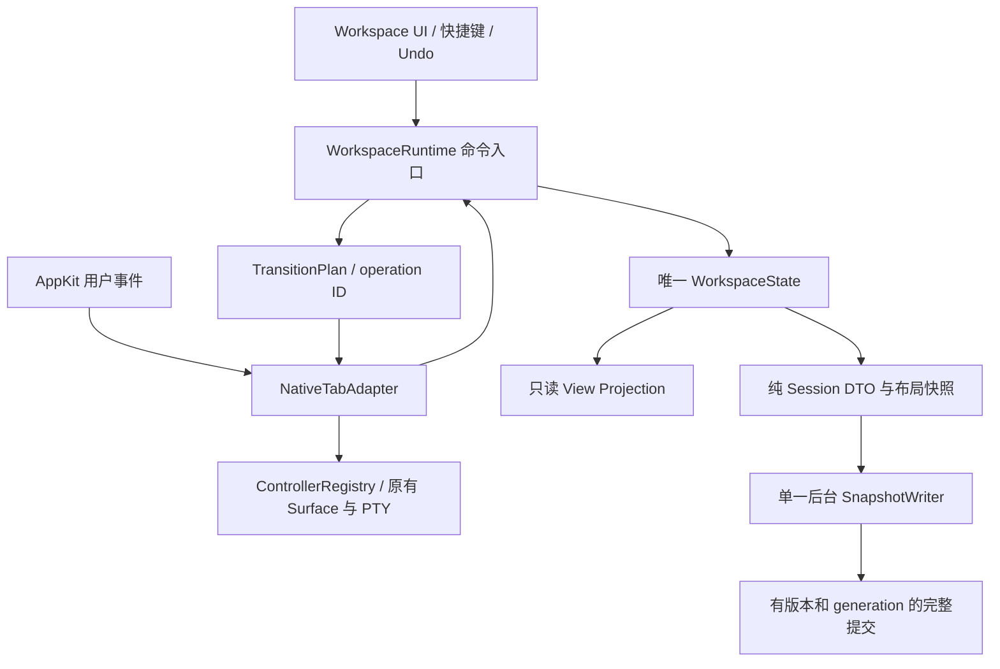

# Terminal Workspace 设计与架构审查 — 2026-10-29

**结论：建议重构 workspace 的状态管理、操作事务与持久化核心，保留 Ghostty 完整宿主、Surface/PTY 生命周期和现有原生 UI 能力。** 当前问题已经跨越关闭/撤销、多窗口可见性、布局共享和恢复一致性。继续在各回调中增加修正分支，可以消除单个症状，但无法保证这些路径组合后的正确性。

本报告是审查与实施建议，不代表重构已经完成。没有修改产品实现，没有提交、推送、安装或替换应用。

## 1. 审查范围与证据

- 基线：`main`，`01bb5305d928`，以及审查开始时已有的四个未提交文件：`TerminalController.swift`、`TerminalWorkspaceCoordinator.swift`、`TerminalWorkspaceView.swift`、`TerminalWorkspaceIntegrationTests.swift`。
- 主范围：命名终端 workspace。包含创建/切换/移动/删除、原生 tab 拆分与合并、关闭/撤销、启动恢复、运行期 checkpoint、布局共享和 UI 发布。
- 关联边界：AppDelegate、TerminalRestorable、SurfaceView Codable、TerminalTabSelectionRestoration、VerticalTabWindowLayoutState、VerticalTabSidebarHost、fullscreen/tab presentation adapter。
- `EditorWorkspace` 和 Files/SSH 的 `WorkspaceProvider` 表示编辑器/文件目录上下文，与命名终端 workspace 是不同概念。本次检查它们的生命周期接入，不声称完成这两个子系统的独立审查。
- 设计依据：`docs/WORKSPACES.md`、`docs/oh-my-ghostty-architecture.md`、`docs/TESTING.md` 与项目 AGENTS。

验证结果：

| 验证 | 结果 | 能证明什么 |
| --- | --- | --- |
| `TerminalWorkspaceTests` + `TerminalWorkspaceIntegrationTests` | **29 tests passed**，测试执行约 13.6 秒 | 已有测试覆盖的正常流程仍成立 |
| 临时审查探针 | **8 个不同探针完成**，其中 checkpoint 探针增加语义比较后复核一次 | 复现本文所述缺陷及局部内部状态破坏 |
| 全屏、真实鼠标拖拽、Spaces/Stage Manager、多屏 | **NOT RUN** | 本报告不声称完成这些桌面行为验证 |
| 真实 SSH/Agent、强杀进程、磁盘故障 | **NOT RUN** | 跨快照故障使用构造的不一致文件验证恢复行为；没有对真实会话做破坏性实验 |

临时探针使用测试进程、临时 session 文件和进程内 catalog；已移出测试目标，归档在 [TerminalWorkspaceReviewTests.swift](workspace-review-2026-10-29/TerminalWorkspaceReviewTests.swift)。**探针断言的是观察到的缺陷，测试通过代表缺陷被复现，不能作为正确行为的验收测试。** 后续修复应转换为正确行为断言并放回正式测试目录。

证据摘要见 [evidence.md](workspace-review-2026-10-29/evidence.md)。原始构建/测试日志在 `/tmp/omg-workspace-review-VLxrNa/`，该临时目录不是长期保存位置。

## 2. 已确认问题

P1 表示应优先处理的恢复数据缺失、窗口不可访问或持久化一致性问题；P2 表示明确的行为错误或性能缺陷。没有发现需要标为 P0 的证据。

### W01 · P1 · 撤销关闭的标签永久被当前进程的 checkpoint 排除

**触发：** 显式关闭标签，再执行 Undo 恢复该标签，之后退出或异常结束应用。

**实际行为：** 标签恢复为可用 Controller，但后续 `capture()` 不再保存它。下次命名 workspace checkpoint 接管启动恢复时，该标签没有可恢复记录。

**根因：** `forget()` 把稳定 `tabSessionID` 加入 `removed`；`capture()` 与按需恢复都排除这个集合。Undo 构造器复用同一 ID，却没有对应的恢复注册事件。`removed` 在当前进程没有清除入口。

证据：

- [TerminalWorkspaceSessionStore.swift:250](../../macos/Sources/Features/Terminal/Workspaces/TerminalWorkspaceSessionStore.swift#L250)：删除记录与添加 tombstone。
- [TerminalWorkspaceSessionStore.swift:259](../../macos/Sources/Features/Terminal/Workspaces/TerminalWorkspaceSessionStore.swift#L259)：捕获时排除 tombstone。
- [TerminalController.swift:3844](../../macos/Sources/Features/Terminal/TerminalController.swift#L3844)：显式关闭调用 `forget`。
- [TerminalController.swift:4190](../../macos/Sources/Features/Terminal/TerminalController.swift#L4190)：Undo 复用 tab/window/group ID，没有恢复持久化资格。

**复现结果：** `restoredAvailable=true, includedInCheckpoint=false`。探针调用真实 UndoState 构造路径；没有模拟菜单按键，也没有真正重启应用。

**应有约束：** Close、Undo、Redo 是同一模型的可逆操作；恢复一个身份必须同时恢复其运行期和持久化资格。

### W02 · P1 · 删除 workspace 会隐藏其他窗口正在显示的默认 workspace

**触发：** A、B 两个窗口都曾打开 Work；B 已切回 Personal，因此 B 的 Work 被 parked；在 A 删除 Work。

**实际行为：** B 当前可见的 Personal 也被 `orderOut`，B 的逻辑窗口没有可见终端。进程和 Surface 仍存在，但用户的另一个窗口消失。

**根因：** `deleteWorkspace()` 对所有 live tab 逐个调用面向“移动当前标签”的 `move()`。`move()` 无条件把目标 workspace 的所有 `incoming` 成员设为 parked 并隐藏。删除结束只重新激活 `visibleHosts`，其中没有原本显示 Personal 的 B。

证据：

- [TerminalWorkspaceCoordinator.swift:319](../../macos/Sources/Features/Terminal/Workspaces/TerminalWorkspaceCoordinator.swift#L319)：以删除前 source workspace 的可见状态计算 `visibleHosts`，循环移动。
- [TerminalWorkspaceCoordinator.swift:389](../../macos/Sources/Features/Terminal/Workspaces/TerminalWorkspaceCoordinator.swift#L389)：隐藏全部 incoming。

**复现结果：** `otherHostVisible=false, fallbackParked=true, fallbackVisible=false`。使用 shared coordinator 和真实 AppKit 窗口完成。

同一设计还有一个内部一致性问题：移动 parked 组的成员时，`groupControllers()` 读取已被 AppKit 拆散的 native group，覆盖 catalog 中完整成员列表。探针中原组 2 个 tab，移动 1 个之后 catalog 源组变为 0 个，但另 1 个 Controller 仍可用。此入口目前由 workspace 删除流程使用；本报告不把它描述为独立的用户菜单操作。

**应有约束：** 删除 label 是按逻辑 window 批量合并归属；只有当前显示被删除 workspace 的窗口需要切换。其他窗口的可见 workspace、焦点与 presentation 应保持。

### W03 · P1 · catalog 与 sessions 没有共同提交边界，恢复会接受不存在的 workspace

**触发：** 创建/删除/移动期间，两份文件只成功写入其中一份，或重启读到不同阶段的快照。

**实际行为：** session 可以恢复成 catalog 中不存在的 workspace ID。显示名称会回退为 Personal，但实际 `workspaceID` 仍是未知 ID；切出后选择器没有对应条目可切回。

**根因：**

1. catalog 使用后台 serial queue，sessions 在主线程同步原子写入；单文件 `.atomic` 不能让两文件成为一次提交。
2. 两份 Snapshot 都只有 schema `version = 1`，没有共同 generation/commit ID。
3. `migrateWindowGroups()` 先把 session 归属补进 catalog，不验证 workspace 外键。
4. `restore()` 再用原始 `tab.workspace` 覆盖 Controller 构造期间的有效归属回退。
5. catalog `isValid` 不验证 `windows/groups` 与 membership 的一致性。

证据：

- [TerminalWorkspaceStore.swift:329](../../macos/Sources/Features/Terminal/Workspaces/TerminalWorkspaceStore.swift#L329)：独立异步 catalog writer。
- [TerminalWorkspaceSessionStore.swift:42](../../macos/Sources/Features/Terminal/Workspaces/TerminalWorkspaceSessionStore.swift#L42)、[同文件:52](../../macos/Sources/Features/Terminal/Workspaces/TerminalWorkspaceSessionStore.swift#L52)：准备与迁移。
- [TerminalWorkspaceSessionStore.swift:200](../../macos/Sources/Features/Terminal/Workspaces/TerminalWorkspaceSessionStore.swift#L200)：覆盖有效归属。
- [TerminalWorkspaceSessionStore.swift:295](../../macos/Sources/Features/Terminal/Workspaces/TerminalWorkspaceSessionStore.swift#L295)：独立 session writer。
- [TerminalWorkspaceStore.swift:188](../../macos/Sources/Features/Terminal/Workspaces/TerminalWorkspaceStore.swift#L188)：有限校验。

**复现结果：** 构造 catalog 无 Work、sessions 仍有 Work 的文件组合：`restoredWorkspaceKnown=false, displayFallsBackToDefault=true, unknownGroupPersisted=true`。这是确定的恢复行为；没有实测强杀恰好命中两次写入之间。

**应有约束：** 每次恢复只接受一个完整提交；所有 tab/window/group/workspace 外键通过校验后，才实例化 Surface。无法解析的记录应隔离并保留证据，不能默默进入正常运行图。

### W04 · P2 · 删除操作返回失败时，已经移动的标签不会回滚

**触发：** 待删除 workspace 有多个 tab，其中后面的 tab 不满足移动条件，或后续 native attachment 失败。

**实际行为：** 前面的 tab 已改归属并隐藏，workspace label 仍在，函数返回 false；用户看到的是一次失败，但部分操作已经生效。

**根因：** 删除只对 attached sheet 做整体预检，其他前提由每次 `move()` 自行检查。循环途中直接 `return false`，没有 operation plan、完整 undo state 或回滚。

证据：[TerminalWorkspaceCoordinator.swift:319](../../macos/Sources/Features/Terminal/Workspaces/TerminalWorkspaceCoordinator.swift#L319)、[同文件:342](../../macos/Sources/Features/Terminal/Workspaces/TerminalWorkspaceCoordinator.swift#L342)。

**复现结果：** 给第二个目标注入真实检查条件 `tabbingMode = .disallowed`，得到 `result=false, labelStillExists=true, tabsAlreadyMoved=1`。非原生 fullscreen 的 `supportsTabs=false` 也属于代码中的移动拒绝条件；该桌面场景未实测。

**应有约束：** 整项操作预检所有参与者；原生副作用完成并校验之前不提交领域状态。失败后恢复旧拓扑，或进入显式可恢复错误状态，不能伪装成未发生。

### W05 · P2 · 同一 workspace 的多个窗口会用旧布局覆盖彼此

**触发：** A、B 都显示同一 workspace；A 隐藏 sidebar，随后 B 打开 Inspector。

**实际行为：** B 不接收 A 的布局变化，并在保存 Inspector 时把旧的 sidebar 值写回。当前 A 仍隐藏，但持久化值已经恢复为显示；两窗口与下次恢复互相不一致。

**根因：** 每个 native group 拥有独立 `VerticalTabWindowLayoutState`；只在 `bindWorkspace` 的 ID 变化时读取共享 store，没有订阅共享偏好。保存时回写所有字段，而不是当前动作改变的字段。Quick Input 已共享 presentation 对象，sidebar/Inspector 却采用另一套机制。

证据：[VerticalTabBarView.swift:106](../../macos/Sources/Features/Terminal/Tabs/VerticalTabBarView.swift#L106)、[同文件:127](../../macos/Sources/Features/Terminal/Tabs/VerticalTabBarView.swift#L127)。

**复现结果：** `persistedSidebarBefore=false, afterUnrelatedInspectorChange=true, firstWindowSidebar=false, secondWindowSidebar=true`。

**应有约束：** 按当前文档，workspace 级布局偏好共享；窗口级只保存 selection、order、scroll 等本地呈现信息。共享偏好采用一个对象或可观察的单向更新，并按字段提交。若产品以后决定改为每窗口布局，必须显式修改数据键与文档，不能由副本竞争决定。

### W06 · P2 · 无变化的 checkpoint 仍反复在主线程编码并替换文件

**触发：** 应用空闲，1 秒 timer 或结构回调调用 `capture()`。

**实际行为：** 即使结构与内容没变，也会重写 session 文件。

**根因：** 每次重新编码所有 live TerminalRestorableState，作为 `Data` 再嵌入外层 JSON。`lastData` 比较 JSON 字节；未稳定化的内层 JSON key 顺序会改变 base64 字符串。外层排序也不能修复内层字符串的变化。`@MainActor` 的 `persist()` 同步执行文件编码、原子替换和 chmod。

证据：[TerminalWorkspaceSessionStore.swift:167](../../macos/Sources/Features/Terminal/Workspaces/TerminalWorkspaceSessionStore.swift#L167)、[同文件:259](../../macos/Sources/Features/Terminal/Workspaces/TerminalWorkspaceSessionStore.swift#L259)、[同文件:295](../../macos/Sources/Features/Terminal/Workspaces/TerminalWorkspaceSessionStore.swift#L295)。

**复现结果：** 10 次同步捕获，`changedBytes=10/10, changedSemantics=0/10, replacedFiles=10/10`；语义比较包含解码内层 `state`，文件替换通过 inode 变化确认。小 fixture 总耗时约 3.9ms，**该数字不能证明大规模会话的卡顿幅度**。

**应有约束：** 先对 typed DTO/revision 判断变化，再由单一后台 writer 合并提交；主线程只复制受限状态。原生拓扑变化不应依靠 timer 才获得模型一致性。

### W07 · P2 · 空 checkpoint 也会屏蔽 AppKit 恢复

**触发：** `sessions.json` 是合法的 `{version: 1, tabs: []}`，同时 AppKit 有可用归档；或所有 tab payload 均无法恢复。

**实际行为：** `prepare()` 立即设置 `ownsRestoration=true`，AppKit 路径被跳过。后面没有恢复出 Controller 时只创建新终端，不再尝试可用归档。

**根因：** 把“文件外层 JSON 可以 decode”等同于“拥有可恢复会话”。这与 `docs/WORKSPACES.md` 的“有效非空 checkpoint 优先”不一致。

证据：[TerminalWorkspaceSessionStore.swift:42](../../macos/Sources/Features/Terminal/Workspaces/TerminalWorkspaceSessionStore.swift#L42)、[同文件:154](../../macos/Sources/Features/Terminal/Workspaces/TerminalWorkspaceSessionStore.swift#L154)、[TerminalRestorable.swift:154](../../macos/Sources/Features/Terminal/TerminalRestorable.swift#L154)。

**复现结果：** 空快照 `ownsRestoration=true`；后续 AppKit 被跳过及新终端 fallback 经调用链确认，未做完整冷启动桌面实验。

**应有约束：** 区分有效非空恢复、用户明确清空、损坏/不可用快照与旧版迁移。用户明确清空时不能误复活旧标签；文件损坏时也不能以“空快照”为由覆盖旧数据。这需要显式状态和恢复策略，不能只加 `tabs.isEmpty` 判断。

## 3. 为什么局部修补难以收敛

### 3.1 同一个事实由多个对象共同决定

| 事实 | 当前写入/判断位置 | 后果 |
| --- | --- | --- |
| tab 的 workspace/window/group 归属 | Controller 可变字段、catalog membership/windows、session Tab、native reconcile、Undo | 任何入口漏写一处都产生漂移 |
| 有序组成员 | 可见时 native group、隐藏时 parkedGroups、catalog Group.tabs、session 数组顺序 | 隐藏后读取 native group 会把完整组降级成单 tab |
| 可见 workspace | Window.currentWorkspace、Controller parked flag、parked 字典、NSWindow.isVisible | 领域可见性与系统可见性相互覆盖；窗口隐藏/minimize/其他 Space 的含义不相同 |
| 关闭与恢复资格 | Controller closing flag、contentView 是否存在、removed 集合、saved.tabs、UndoState | 缺少统一的 suspended/deleted/restored 生命周期 |
| workspace 布局 | catalog Presentation、各组 LayoutState 副本、QuickInputGlobalPresentation | 同一产品语义被两种同步机制实现 |

`TerminalController.all` 来源是 `NSApplication.shared.windows`，不是显式 live session registry。协调器因此不断通过内容视图、原生组和 flags 推测逻辑状态。维护 `parked` 强引用本身有必要，但它目前同时承担生命周期、可见性和归属的部分权威职责。

### 3.2 原生回调会反向修改领域状态

`refreshTabs` 不仅更新 UI，还调用 `reconcileNativeGroup` 改写归属；`capture()` 不仅保存数据，也执行 reconcile。恢复、绘制、持久化均可能修改“谁属于谁”，因此它们不是可独立推理的下游操作。

`TerminalWorkspacePresentation.depth` 是全局发布抑制，协调器另有 `isSwitching/restoring/quitting`，session store 还有一套 `started/restoring/quitting/ownsRestoration`。这些布尔值分别遮住某些回调，但没有表达一项操作从准备、提交到失败的完整状态。

全局锁并非当前已证明的并发错误；真正的问题是被抑制的事件没有一致的重放/校验协议。全屏的异步完成又超出同步 `depth` 范围，只能靠 presentation retry 修正。

### 3.3 持久化直接耦合运行对象

Session store 编码 `TerminalRestorableState<SurfaceView>`；解码 SurfaceView 会创建 surface，并处理 Agent/SSH/runtime 恢复配置。这意味着不能先完整验证一张恢复图，再决定是否启动运行对象。`try?` 对失败 tab 静默跳过，也缺少每条失败原因与可恢复备份。

另一个设计决策需要在重构时明确保留或调整：当前只要存在 workspace checkpoint，就强制 `restoreSessions`，覆盖设置中的 `restoreTabs/newTerminal`；文档明确写了这个优先级，因此本报告不将其冒充实现 bug。问题在于它分散在 SessionStore、SurfaceView decoder、AppKit restoration 和 AppDelegate，多处判断容易继续分叉。

### 3.4 测试的注入边界并不完整

`TerminalWorkspaceCoordinator(store:sessions:)` 看似可注入，但 Controller 构造/注册/布局/回调仍直接访问 `.shared`；自定义 SessionStore 的 `capture()` 也调用 shared coordinator。

现有测试为了建立 fixture，经常先让 Controller 在 shared store 注册，再直接改 `workspaceID`，随后用另一套 coordinator 操作。这能验证局部几何和 surface identity，却难以证明完整依赖图正确。29 个现有测试全部通过与本文缺陷并不矛盾。

测试重点偏向正常路径和已出现的单次回归：缺少 Close→Undo→Checkpoint、跨窗口 Delete、不同提交文件组合、失败的第 N 次 native attachment、语义无变化的写入次数。并非没有测试，而是需要围绕模型不变量与操作组合重新组织测试。

## 4. 推荐的目标架构

继续使用 Ghostty macOS App 及原生 tab/fullscreen。重构边界是命名 workspace 的领域核心和宿主适配，不扩张到 renderer、PTY 协议或完整终端重写。

建议职责如下；名称是设计草案，不是要求引入框架或 event-sourcing 平台。

| 组件 | 唯一职责 | 不能做的事 |
| --- | --- | --- |
| `WorkspaceState` | workspace catalog、logical window、group、tab ownership、selection、生命周期的规范状态 | 持有 NSView、启动 PTY、根据 NSWindow 数组猜归属 |
| `WorkspaceRuntime` | 接收 switch/move/delete/close/undo/native-detach 等命令；预检、生成计划、提交 | 让任意 observer 直接修改模型 |
| `ControllerRegistry` | `TabID -> TerminalController` 运行对象的查找与保活 | 把窗口枚举顺序当作领域顺序 |
| `NativeTabAdapter` | attach/detach/show/park/frame/fullscreen/focus；上报用户原生操作 | 保存 workspace 文件或自行选择归属 |
| `WorkspacePreferences` | workspace 级共享布局的单一可观察状态 | 在每个 native group 保存可写共享偏好副本 |
| `SnapshotWriter/Loader` | 版本迁移、校验、后台原子提交、备份与恢复优先级 | 从 AppKit 临时拓扑反推模型 |
| UI projection | 读取已提交状态，发出命令 | 根据 rows、hover 或视图出现/消失决定会话所有权 |

### 4.1 先建立并检查不变量

1. 每个有效 tab 恰好属于一个 `(WindowID, WorkspaceID, GroupID)`；每个 group 只属于一个 window/workspace。
2. 一个 logical window 至多有一个已提交的当前 workspace；后台 group 不能因其他窗口删除/切换而被激活或隐藏。
3. group order 不含重复 tab；非空组的 selected 必须属于该组。
4. 切换、移动和删除 label 保留 live Controller、Surface、PTY 身份；只有明确恢复关闭记录才创建运行对象。
5. `liveVisible`、`liveParked`、`suspended`、`deleted` 有明确操作语义；Undo 是从 closed/deleted 状态恢复的正式命令。
6. native tab group 只在稳定状态与领域投影一致；混合交接组不能被持久化或用于重新推导归属。
7. 一次成功操作产生一个完整 revision；失败操作保留旧 revision，或记录显式待恢复状态。
8. 共享 workspace 偏好一致；window/group 的 order、selection、scroll 独立。
9. 无变化快照不写盘；持久化数据引用的 workspace/window/group/tab 都有效。

不需要强制所有 workspace 永远有 tab。首次访问创建空终端、移动最后一个 tab 补终端、显式删除最后一个 tab/关闭窗口分别是不同命令，不能用一条“永远非空”规则覆盖。

### 4.2 原生交接必须成为可验证的事务

- 预检源/目标的全部成员、sheet、tabbing 能力、生命周期和目标存在性。
- 从模型冻结 outgoing/incoming 与目标 selection，生成 `TransitionPlan`，包括补偿所需的原始顺序、frame、layout 和 visibility。
- adapter 执行 AppKit 操作；每次返回值都参与判断。当前 `activate()` 和 startup 的部分 attachment 结果被忽略，应统一处理。
- native callbacks 区分“本事务触发的回声”与外部用户操作，按 window/operation ID 收敛；新操作让旧异步回调失效。
- 校验最终拓扑后一次提交并发布。失败则回滚，不写入混合快照。
- native fullscreen 是异步系统操作，需要显式等待完成/失败并处理用户取消；同步 screen-update suppression 只负责画面，不承担事务正确性。

跨窗口删除在领域层是一次批量重归属。每个 window 有自己的 presentation plan：当前显示被删 workspace 的窗口切换到 fallback，其他窗口只更新成员，不能复用会主动隐藏目标组的交互式 `move()`。

### 4.3 持久化以完整提交为单位

推荐先采用**一个版本化 envelope JSON** 保存相互引用的 catalog、window/group 与纯 tab descriptors；规模证据暂不需要引入数据库。后台写临时文件并原子替换，保留上一份有效版本。若实测数据规模要求拆文件，应使用 generation 目录与最后写入的 manifest 指针来提交一组文件，不能继续独立覆盖两个权威文件。

Load 的顺序：读取 → schema 迁移 → 验证完整图 → 明确 startup policy → 实例化运行对象 → native projection。不得在 schema decode 阶段启动 Surface。

现有 v1 格式只作为迁移输入。迁移输出做完整校验，保留原文件与迁移报告。不要在 normal startup 一边从旧 session 补 catalog，一边持续覆盖旧数据。

结构变化驱动 revision；cwd/title/typed resume 变化通过事件或轻量 dirty tracking 汇总。必要的周期检查可以保留，但不得借采样修正所有权，也不得无条件全量写盘。

## 5. 继续修补与重构的取舍

| 路线 | 短期作用 | 后续成本 | 建议 |
| --- | --- | --- | --- |
| 对各回调继续加判断 | 可以较快处理 W01/W02 等单个故障 | 仍需同步多份状态，每个新动作扩大组合空间 | 仅适合作为紧急止损 |
| 重构 workspace 核心，保留宿主与 UI 能力 | 需要先建立模型、适配和迁移测试 | 归属、事务、持久化可独立验证；后续功能有稳定边界 | **推荐** |
| 重写完整窗口/Tab/终端宿主 | 可完全改变原生呈现方式 | 要重新承担输入、IME、fullscreen、拖拽、恢复和 upstream 兼容 | 当前证据不支持，超出必要范围 |

建议保留：稳定 tab/surface/window 标识、运行期切换不重建 PTY 的目标、typed Agent/SSH/runtime descriptor、原生 sidebar host 复用、已有 fullscreen 首帧准备能力、picker 的独立 popover owner，以及已验证的正常路径测试。

建议替换：Coordinator 中零散的所有权写入、parked 与 native 两套成员权威、永久 removed tombstone、SessionStore 对 Controller 的反向 reconcile、两文件独立提交、可写布局副本，以及 scattered shared 依赖。

将几百行函数拆成更多 extension 不足以完成这次重构；验收标准是状态写入入口与不变量发生变化。

## 6. 分阶段落地

| 阶段 | 交付 | 完成条件 |
| --- | --- | --- |
| 0：固定行为契约与故障证据 | 把本文探针转成正确行为回归；记录 Close Tab / Close Window / Delete Workspace / Undo 和 startup policy | 7 项缺陷都有独立验收场景，产品语义没有模糊交集 |
| 1：纯状态模型与依赖边界 | typed IDs、Window/Group/Tab 状态、reducer/命令计划、ControllerRegistry；实例级依赖替代 shared 越界 | 无 AppKit 的测试能验证归属/顺序/选择/撤销；生产入口统一经过 runtime |
| 2：完整持久化提交 | DTO、v1→v2 importer、单 writer、generation/备份、错误恢复；保持唯一写入者 | 旧数据迁移及中断写入后只加载一个完整图；无变化不落盘 |
| 3：替换运行期交接 | 先 switch，再 move/delete，再 native detach/join 与 undo；native adapter 收敛回调与失败 | 每一步注入失败后不丢 tab、不串窗口、不留下部分提交；异步回调有版本边界 |
| 4：统一布局与恢复入口 | workspace preferences 共享；逻辑窗口恢复、全屏/焦点异步完成统一管理 | 多窗口布局一致、selection/scroll 独立，startup policy 只定义一次 |
| 5：移除旧状态与桌面验收 | 删除旧 parked-membership 权威、旧 tombstone、运行期 v1 写入与补丁回调 | 新模型是唯一写入来源，完成下方场景矩阵 |

实施时可让旧/新模型做只读对照，在日志中检查投影差异；生产同一时间只能有一个 runtime 和一个 snapshot writer。不要让新旧代码双写，再指望恢复时挑对版本。

阶段 1→2→3 的关键是先统一模型与持久化边界，再替换高风险 native 副作用。若需要先止损，W01/W02/W04 的小修应配完整回归，但不要把这些修复当成整体重构完成。

## 7. 验收矩阵

| 维度 | 必测组合 |
| --- | --- |
| 模型操作 | create / switch / move / delete / close tab / close window / undo / redo 的长序列；每一步检查不变量 |
| 多窗口 | 2–3 个 window；相同/不同 current workspace；删除前目标 visible/parked/suspended；不能影响无关窗口 |
| 组成员 | 1 个 tab、多个 tab、split；移动最后一个；删除多个 parked 组；native detach/join 后 undo |
| 故障 | 第 N 个 attach/show 失败、目标消失、活动 sheet、tabbing 不允许、退出确认取消、操作期间进入/退出全屏 |
| 恢复 | v1 迁移、空的显式删除、空/损坏文件、单条 payload 损坏、重复 ID、缺失外键、上一代备份、写入各阶段被中断 |
| 身份 | live switch/move/delete 前后 Controller/Surface identity 不变；恢复 closed 记录时稳定 tab/pane ID 不重复实例化 |
| 布局 | 同 workspace 跨窗口共享设置；不同 workspace 隔离；order/selection/scroll 每窗口独立；快速往返不被旧回调覆盖 |
| 桌面 | horizontal/vertical；普通/原生 fullscreen；快速切换；新建/关闭/拖出/合并；多屏、Space、minimize、Dock/Window 菜单激活 |
| 性能 | 10/100/500 tabs 的切换耗时、主线程占用、快照大小与写入次数；空闲无变化不写盘；后台 Surface 不额外重建 |
| 会话能力 | local、SSH、Agent、runtime attach；switch 保活与 cold-start 恢复分别验收，不把进程重建称为保活 |

推荐自动化优先级：纯模型状态序列测试 → 文件迁移/故障注入 → 可控 native adapter → 少量真实 AppKit 集成 → 解锁前台桌面全屏/拖拽验证。真实 AppKit 测试仍必要，但不能承担全部领域规则的验证。

## 8. 本次结论的边界

已确定的缺陷足以支持核心重构建议，但没有证明所有全屏闪烁、焦点或 SSH 问题都来自同一个原因。审查中已有的未提交 popover 改动及其测试已纳入 baseline；没有证据支持为重构而丢弃这项改动。

建议下一实施单位是 **WorkspaceState + 生命周期命令 + 持久化 DTO 的最小闭环**，以 W01、W02、W03 的回归作为第一批验收，再逐步把 native 切换接入。这样每阶段都有可验证行为和清晰替换边界。
